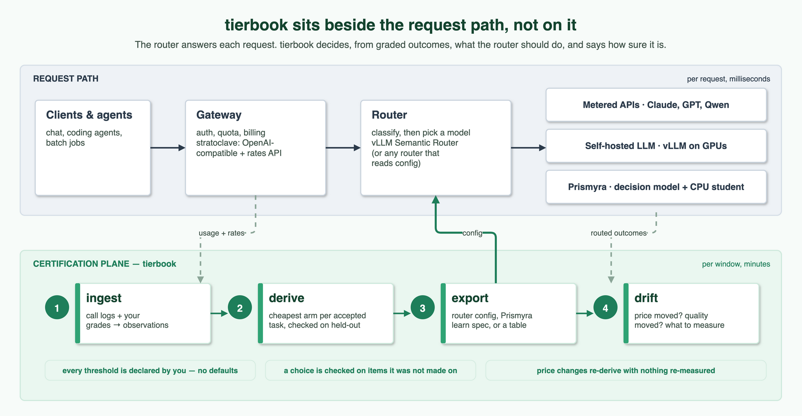
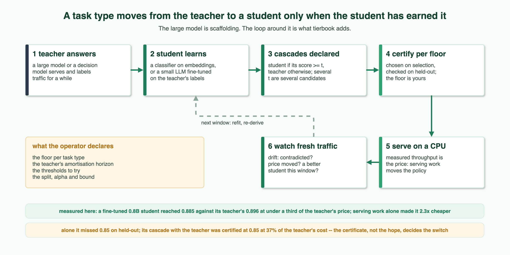
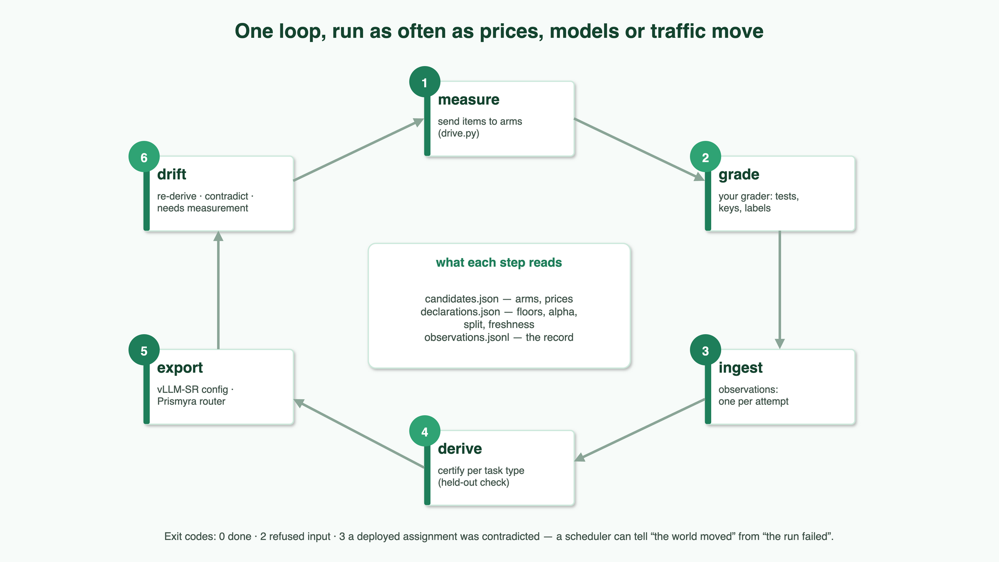
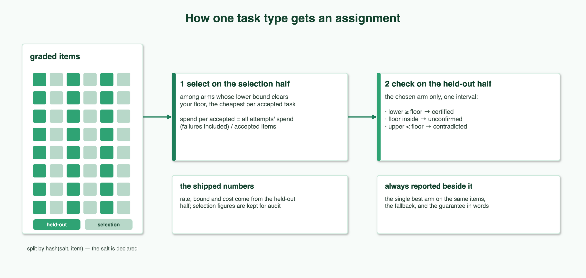
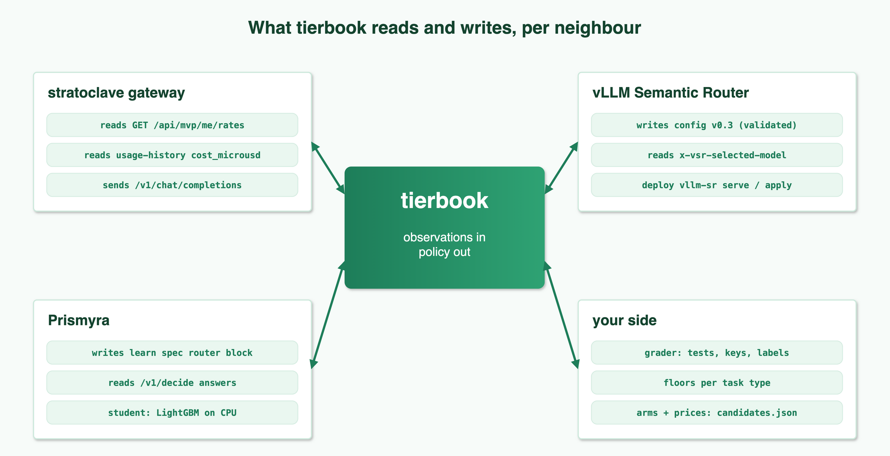
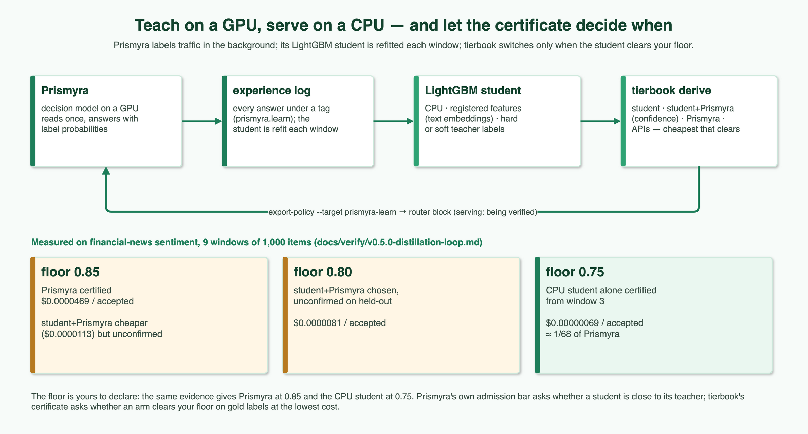
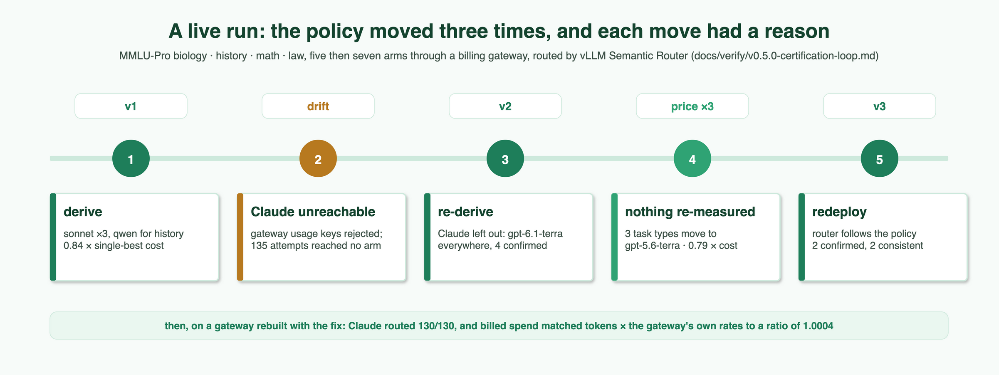

# tierbook

**Grow the cheap arm, and switch to it only when it has earned it.** tierbook is the operations loop that moves your
traffic, task type by task type, onto the cheapest arm that is good enough — often a small, fast student grown from
your own traffic and taught by a large model — and moves it only when a certificate says so: the arm's acceptance on
items it was not chosen on clears the floor you declared, priced at today's rates. It re-decides when prices, models,
students or outcomes move, and writes the decision into the router you already run.



**You bring** a log of calls (task type, model, tokens), a grade per attempt from your own grader, a price per model,
and a minimum acceptance rate — a *floor* — per task type. **You get** `policy.json`: per task type, which model (an
*arm*) to use, whether that choice is *certified* (its confidence bound on items it was not chosen on clears your floor),
what it costs per accepted task, and a configuration for your router.

Routers such as [vLLM Semantic Router](https://github.com/vllm-project/semantic-router) and LiteLLM pick a model per
request. tierbook does a different job: it derives the per-task-type choice from your graded outcomes, attaches a
held-out confidence bound to it, and writes it into their configuration. It never sits in the request path. The survey
of what routers do today is in [`docs/prior-art-2026-11.md`](docs/prior-art-2026-11.md).

## The idea



A large model is where a task type starts, not where it has to stay. Its answers are the lesson; the arm that serves can
be a student trained on them — a LightGBM classifier on text embeddings, a 0.8B LLM fine-tuned on the teacher's labels —
that answers in milliseconds on a CPU. What tierbook adds is not the student or the teacher but the discipline of the
loop around them:

1. **The teacher is scaffolding.** It labels traffic for a while; the student serves. Its bill is a one-off cost of the
   lesson, amortised over a horizon you declare, not a cost per request.
2. **Switch on a certificate, not on a hope.** A student takes a task type only when its held-out lower bound clears
   the floor, and the policy says so per window as it improves.
3. **How much accuracy to trade for cost is yours.** A floor is declared per task type; the same evidence certifies the
   teacher at one floor and the student at a lower one, and tierbook will not pick the floor for you.
4. **A threshold is part of the arm.** "The student answers when it is sure, the teacher otherwise" is a
   [cascade](#cascades-student-when-sure-teacher-otherwise) with a declared threshold, priced from what both actually
   consumed. Each extra threshold is another candidate, and more candidates make it likelier that a lucky one is chosen
   and then fails the held-out check; choose thresholds on data you do not certify on, or declare few
   ([Husain and Saha](https://hamel.dev/blog/posts/decision-model-evals/) make the same point for decision-model evals).
5. **Serving is part of the price.** An arm's price is its measured throughput, so making a student cheaper to serve
   moves the policy the way a price change does. One fine-tuned 0.8B student became 2.3× cheaper to serve on the same
   CPU by serving work alone, with every label unchanged.

## Why

| | measured, in this repository |
|---|---|
| A policy that splits task types across models costs less than the best single model on the same items | **0.84 ×** the single-best cost per accepted task (five arms, 489 common held-out items); when only one arm was worth using, the policy said so (**1.00 ×**) ([record](docs/verify/v0.5.0-certification-loop.md)) |
| A price change re-derives the policy with nothing re-measured | a probe that tripled one arm's rate moved three of four task types and brought the policy to **0.79 ×** the single-best cost (508 items); the live router followed |
| A small CPU model taught by a decision model can take over routine traffic — at a floor you allow | a LightGBM student (sentence-embedding features) certified at a declared floor of 0.75 at **$0.00000069** per accepted task, with the teacher's labelling cost amortised over a declared 1,000,000 requests: about **1/68** of [Prismyra](https://github.com/littlemex/Prismyra), the decision model that certifies at 0.85. At 0.80 and 0.85 the student was not certified ([record](docs/verify/v0.5.0-distillation-loop.md)) |
| A choice reported on the data it was made on looks better than it is | 6.7 points between the point estimate and the guaranteed bound on this project's own search ([results](docs/results-selection-cost.md)); every assignment here is checked on a held-out half |

## How it works



Four verbs, each a pure function from files to a file. The loop is their composition; run it as often as anything moves.

| verb | reads | writes |
|---|---|---|
| `tierbook ingest` | a call log and your grades | `observations.jsonl`, one line per attempt: tokens, latency, outcome |
| `tierbook derive` | observations, `candidates.json` (arms, prices), `declarations.json` (floors, alpha, split) | `policy.json`: per task type an arm, a status and why |
| `tierbook export-policy` | a policy | a vLLM Semantic Router config, a Prismyra learn spec, or a plain table |
| `tierbook drift` | the deployed policy, fresh observations, today's prices | what a re-derivation changes, which assignments fresh traffic contradicts, what needs measuring |

tierbook never grades. Acceptance is yours — a test suite, an answer key, a human label. How an attempt with no gradable
answer counts is declared too (`unobserved_as`); the examples count it as rejected rather than dropping it. The three
input files and one example line of each are in the design document,
[§2](docs/DESIGN-v0.5-certification-plane.md#2-the-pipeline).

## Quickstart

Offline, on measurements this repository ships: the three arms of the recorded run that policy v1 chose between
(MMLU-Pro biology, history, math, law; 1,000 items; arm names are the gateway's model aliases).

```bash
git clone https://github.com/littlemex/tierbook.git
cd tierbook
python3 -m venv .venv && .venv/bin/pip install -q .
S=examples/certification_loop/sample
.venv/bin/tierbook derive --observations $S/observations.jsonl --candidates $S/candidates.json --declarations $S/declarations.json --out policy.json
```

Each line is a task type, its status, the arm, the held-out cost per accepted task, and the reason (cut short here):

```
biology    certified  claude-sonnet-5   $0.001342/accepted  cheapest per accepted task among 1 that cleared selection; ...
history    certified  qwen3-next-80b    $0.000069/accepted  cheapest per accepted task among 2 that cleared selection; ...
law        certified  claude-sonnet-5   $0.001916/accepted  cheapest per accepted task among 1 that cleared selection; ...
math       certified  claude-sonnet-5   $0.001875/accepted  cheapest per accepted task among 1 that cleared selection; ...
policy $0.001371/accepted vs single best claude-sonnet-5 $0.001628/accepted on 489 common held-out items of 4 certified task type(s)
```

The assignment as plain data, for any router:

```bash
.venv/bin/tierbook export-policy --policy policy.json --target table --out table.json
```

Now suppose one vendor raises its price fiftyfold (a probe in a shipped candidate file, not a quoted price). Nothing is
re-measured, and with no `--fresh` traffic only the re-derivation is reported:

```bash
.venv/bin/tierbook drift --observations $S/observations.jsonl --deployed policy.json --candidates $S/candidates-qwen-x50.json --declarations $S/declarations.json --out drift.json
```

```
inputs   declarations changed: False, candidates changed: True
changed  history: {'status': 'certified', 'arm': 'qwen3-next-80b'} -> certified claude-sonnet-5
```

Hand the policy to a router with `export-policy --target vsr` (vLLM Semantic Router) or `--target prismyra-learn`
(Prismyra's own router). `prismyra-learn` also writes an admission record in Prismyra's format: the version judged, the
router block, and the policy's digest. Prismyra then serves only an artifact of that version under exactly that block,
and refuses a refit until a new judgement covers it. A certificate that names no version is refused unless
`--allow-unversioned`. The full loop against live endpoints is in
[`examples/certification_loop/`](examples/certification_loop/README.md).

## What a certificate means



| status | meaning | exported? |
|---|---|---|
| `certified` | the held-out lower bound clears the floor | yes |
| `unconfirmed` | the floor lies inside the held-out interval | only with `--allow-unconfirmed` |
| `contradicted` | the held-out upper bound is below the floor | never |
| `unassignable` | nothing cleared the floor on selection, or a declaration is missing | never; the policy's fallback answers |

Everything that decides what is certified is declared by you, with no defaults: the floor per task type, alpha, the
bound method (`tierbook.bounds:wilson` ships; any `module:attribute` works), the split, how unobserved attempts count,
how long evidence stays fresh, whether the guarantee holds per task type or for the policy as a whole, and how many
arms the held-out half may check (`holdout_ladder`).

`holdout_ladder: 1` checks only the cheapest arm that cleared selection. A larger value (or `"all"`) builds a ladder on
the selection half alone: the arms that are cheaper than every arm with a higher selection lower bound, the k cheapest
of them, checked on the held-out half dearest first, each at the full alpha, stopping at the first that does not
clear. The cheapest confirmed rung is certified. This is a fixed-sequence test, so checking more arms does not loosen
the guarantee; what it changes is that an arm which barely cleared selection no longer hides a dearer one that holds.
A rung that fails stops the ladder, so cheaper rungs below it are reported as not reached, never as evidence. The
guarantee is printed in words in every policy, including what it is conditional on.

A certificate covers the task type as your labels define it. Once a router classifies requests, it says nothing about
the ones the classifier puts elsewhere — in the recorded run, 18-21 % of routed requests did not reach their own task
type's decision. Looking at the same held-out half again after adding evidence makes the nominal confidence optimistic;
declare a fresh `split_salt` to avoid it (the recorded runs did not, and say so).

## Where it plugs in



| neighbour | tierbook reads | tierbook writes |
|---|---|---|
| a gateway ([stratoclave](https://github.com/littlemex/stratoclave), at or after the commit `infra/tierbook-up` pins) | `GET /api/mvp/me/rates` for prices (the gateway's own endpoint name); usage-history `cost_microusd` to reconcile against the bill | — |
| vLLM Semantic Router | `x-vsr-selected-model` on routed responses | a config that its own `vllm-sr config validate` accepts (0.4.0 and the 0.5.0 development builds) |
| Prismyra | `/v1/decide` answers and its experience log | the `router` block of a tag in its learn spec |
| your side | grades, floors, arms and prices | — |

Anything that speaks an OpenAI-compatible API can be an arm: a vendor API, a gateway in front of several, a model
server on your own GPUs, or a decision model and its CPU student. An arm without a token price (a self-hosted or
fixed-cost one) is priced from a declared cost per attempt with its source, typically an hourly price over a measured
throughput.

## Teach on a GPU, serve on a CPU



For a routine closed-label task — sentiment, intent, a yes/no check — the cheapest arm that clears the floor can be a
small model trained on the traffic itself. [Prismyra](https://github.com/littlemex/Prismyra) answers in the background
and logs what it answered; its learn pipeline refits a LightGBM student on that log every window, with text embeddings
registered as features; tierbook certifies, per window, whether the student, the student routed by confidence, or
Prismyra itself is the cheapest at your floor, and exports the decision as the router block of Prismyra's learn spec.
That loop ran end to end: at a floor of 0.80 the policy certified Prismyra's confidence-mode router at a fifth of
Prismyra's cost per accepted task, Prismyra served the exported spec, the student answered 68 % of 300 fresh requests
in a median 13.8 ms, and `drift` confirmed the assignment (263 of 300 accepted). The run behind the
numbers is in [`docs/verify/v0.5.0-distillation-loop.md`](docs/verify/v0.5.0-distillation-loop.md) and the pieces in
[`examples/distillation_loop/`](examples/distillation_loop/README.md).

The student need not be a classifier. A `Qwen/Qwen3.5-0.8B` fine-tuned on the teacher's labels accepted 0.885 of the
certification items against the teacher's 0.896 and the LightGBM student's 0.810, served on a 4-vCPU Graviton4
instance at under a third of the teacher's price per attempt. At a floor of 0.85 the student alone fell short on the
held-out half; its cascade with the teacher was certified at 37 % of the teacher's cost per accepted task, and the
version an OpenAI-compatible router can serve (a student that generates its label) at 41 %, on a second look at more
items with alpha halved for that look (across both looks a false certificate has a chance of at most 0.0323 by the exact binomial tail, against at most 0.0204 for the first look alone).

### Cascades: student when sure, teacher otherwise

A cascade is a candidate built from two others. Declare it in `candidates.json`:

```json
"student-or-teacher": {"cascade": {"primary": "student", "fallback": "teacher", "threshold": 0.9, "on_no_score": "fallback"}}
```

and record the student's own score on each call (`"score": 0.97` on the call-log row, higher meaning surer; `ingest`
carries it; the example `drive.py` does not produce one, because only the arm knows its confidence). tierbook composes the cascade's attempts from the parts' attempts: the student's answer where its score is
at least the threshold, the teacher's answer at the same item and run where it is not. The cost is every student
attempt plus the teacher on the deferred ones, each part priced on its own card or declaration, and the policy records
the cascade's definition beside the assignment.

Nothing is defaulted. `on_no_score` says what a student attempt without a score does (`fallback` or `unobserved`); a
deferred item the teacher never answered is `unobserved`; an attempt recorded under the cascade's own name is refused,
because the record cannot say which part answered or what each consumed. The fallback may itself be a cascade; the
primary may not, because a cascade's attempts carry no score of their own. Several thresholds are several candidates,
chosen on selection and checked on held-out like any arm. vLLM Semantic Router runs a cascade with its confidence
looper: `export-policy --target vsr --cascade-confidence avg_logprob` writes one, and refuses without that
declaration, because the certificate holds only if the recorded score is the confidence that router computes. A
cascade over a 0.8B student and Prismyra ran that way end to end: the router's choice equalled the recorded score's on
all 300 routed items, and `drift` found the assignment consistent. A student served this way has to generate its
answer, so it is trained to; one that only reads label logits needs a router that runs it, such as Prismyra's own for
the students Prismyra trains (`--target prismyra-learn`).

## A live run



Five, then seven arms behind a billing gateway, routed by vLLM Semantic Router 0.4.0 across three deployments. The
first exposed a gateway defect: Claude responses carried non-canonical usage keys, which the router rejects. The second,
with the unreachable Claude arms left out of the candidate file, assigned every task type to one arm. The third followed
a price probe. Each move came with a reason in the drift report. Claude arms were later routed end to end on a fixed
gateway with a vllm-sr 0.5.0 development build ([record](docs/verify/v0.5.0-certification-loop.md)).

## Install

Python 3.10 or newer, from source (there is no PyPI release):

```bash
pip install .
pip install '.[dev]'
```

The second line adds what the test suite needs. The router, Prismyra and the gateway are separate projects; tierbook
needs none of them installed to derive a policy.

## Command reference

| command | what it does |
|---|---|
| `ingest --calls C --outcomes O --out obs.jsonl [--cache-additive-arm ARM] [--arm-version ARM=V]` | join a chat-completions log to grades; `--append` to add to an existing file; `--arm-version` stamps an arm's attempts with an opaque version |
| `check-provenance FILE [--sha256 H]` | read an arm's provenance and the item sets it cites, and print the digest to cite it by; writes nothing |
| `power --floor F --assumed-rate P --alpha A --power Q --bound B --max-n N` | held-out items an assumed rate needs to pass a floor |
| `check-observations FILE ...` | parse observation files as `derive` does and print each arm's versions, paths and outcome counts; writes nothing |
| `derive --observations ... --candidates C --declarations D --out policy.json [--as-of T] [--ledger L]` | certify per task type; `--ledger` counts this as a look at each held-out set |
| `drift --observations ... --deployed P --fresh F ... --out drift.json` | diff, contradiction checks, cells to measure; exit 3 on a contradiction |
| `export-policy --policy P --target vsr\|prismyra-learn\|table --out ...` | translate a policy for a router; refuses what the target cannot express |
| `validate`, `explain`, `compile`, `route`, `export-vsr`, `assign`, `accept`, `admit-*` | the ledger workflow, still supported: [`docs/ledger-path.md`](docs/ledger-path.md) |

Exit codes: `0` done, `2` refused (bad input, a missing declaration, an export the target cannot express), `3` a
deployed assignment was contradicted by fresh evidence.

## Design

* **A mechanism, not a policy.** No list of good models, signals or task types lives in the code, and no threshold comes
  from one corpus; a study that reached the opposite conclusion must be able to express it through the same files
  ([`SCOPE.md`](SCOPE.md)).
* **Price is separate from measurement.** Observations carry tokens; cost is recomputed from today's candidate file.
* **A certificate may be bound to what answered.** An observation may name an opaque `arm_version`; an arm whose fresh
  rows name two versions is refused, the policy names the version it certified (per component for a cascade), and
  `drift` refuses fresh rows from another version. A certificate issued over unversioned rows binds nothing, and
  `drift` says so. A declared `interfaces` list keeps arms a router cannot serve out of selection; with it declared,
  every candidate, cascades included, must say what it is.
* **A trainer's claims only subtract.** A candidate may cite what its arm was trained on and which sets its maker
  saw; an arm whose held-out items appear there is excluded from selection, and checks that cannot be made are
  reported as unchecked. Nothing a trainer claims can admit an arm.
* **Arithmetic is computed, not typed.** Prices may be declared as their inputs, every held-out cell carries the exact
  chance an at-floor arm passes, `power` sizes a held-out set before looking, and `derive --ledger` counts looks.
* **The unit is the item.** Repeated runs of one item combine by a declared rule rather than counting as independent
  evidence.
* **Refusals come from the record.** A missing floor, an unpriced arm, stale evidence or an unservable export is a
  named refusal, never a silent default.

The full design and why it is shaped this way: [`docs/DESIGN-v0.5-certification-plane.md`](docs/DESIGN-v0.5-certification-plane.md),
from the survey in [`docs/prior-art-2026-11.md`](docs/prior-art-2026-11.md).

## Repository layout

| path | what |
|---|---|
| `src/tierbook/` | the package; `certify.py`, `observation.py`, `bounds.py` and `certify_cli.py` are the certification plane |
| `examples/certification_loop/` | measure → grade → derive → route → drift against live endpoints, plus the offline sample |
| `examples/distillation_loop/` | Prismyra as teacher, its LightGBM student, tierbook's certificate |
| `docs/verify/` | the real-machine records behind every number on this page |
| `docs/diagrams/`, `docs/images/` | the figures' draw.io sources and their rendered PNGs (`python docs/diagrams/gen.py` regenerates both) |
| `infra/` | bringing a gateway (and optionally a cluster) up from scratch for verification |

## How this differs, and what it has not shown

The parts exist elsewhere. What we have not found elsewhere is the combination: a switch happens only when a lower
confidence bound on the acceptance rate (at a declared confidence, 95 % in the runs here), computed on items not used
to choose, clears a declared floor; prices are kept apart from measurements; and the loop is run end to end on billed
calls and live routers, so far on benchmark items.

| | prior work and tools | what this adds |
|---|---|---|
| Cascades and confidence thresholds | FrugalGPT, AutoMix, vLLM Semantic Router's confidence looper; RouteLLM's cost threshold (a router, not a cascade) | a cascade is one candidate, priced from what each part consumed, and certified on the same score the router computes at serving time (the two matched on 300 of 300 routed items) |
| Distilling traffic into a cheaper model | OpenPipe, Predibase, provider distillation APIs | the student takes a task type only when its held-out lower bound clears a declared floor, re-checked every window |
| Evaluation, gates and monitoring | Braintrust, Langfuse, LangSmith, promptfoo | a gate that is a confidence bound on items the choice was not made on, plus `drift` on fresh traffic after the switch |
| Price tables and cost tracking | LiteLLM, Langfuse, OpenRouter | cost per accepted task recomputed from today's prices, so a price change re-derives the policy without re-measuring, as long as the model behind the price is unchanged |
| Choosing on one sample and testing on another | Learn then Test, Pareto Testing, and related work | the same method, including its fixed-sequence testing, applied to model assignment: arms are tested in an order fixed before the held-out half is seen, stopping at the first failure |

Not yet shown, and worth knowing before relying on it:

* **Breadth.** One author, and hundreds to a few thousand items per run. The distillation lane is one easy
  closed-label task; the routed loop is multiple-choice MMLU-Pro. Open-ended generation, where acceptance needs a rubric
  or a judge model rather than an exact match, is untested.
* **The grader is yours.** The certificate bounds how often your grader accepts; it says nothing about whether the
  grader is right. Where the grader is itself a model, its errors pass into the certificate, and checking it with a
  second model judge may not help: Rao and Callison-Burch find decision-model and LLM rubric judges
  [wrong in the same places](https://arxiv.org/abs/2609.29769), with a cascade between them gaining at most 2.7 points
  over the best single judge. The same paper is a reason a cascade's gain is measured here rather than assumed.
* **What the bound covers.** It is conditional on your task-type labels and on future traffic resembling the
  evaluated items; requests a classifier sends to the wrong task type (18-21 % of routed requests in two deployments here, about a
  fifth of the traffic) are outside it.
* **Declared numbers.** Amortisation horizons and price probes are declarations, and the savings they produce move
  with them; a self-hosted arm is priced at full utilisation unless you declare otherwise, which understates its cost when the
  hardware sits idle.
* **The benefit over a simpler rule** (switch on the point estimate) has not been measured as errors avoided against
  savings forgone.
* **Independence and maturity.** The teacher (Prismyra) and the gateway (stratoclave) come from the same author;
  there is no third-party reproduction yet, no PyPI release, and running more than one router replica is untested.

## Status

v0.5.0. The certification loop runs end to end on billed traffic through vLLM Semantic Router. The distillation lane
runs end to end through Prismyra's own router: Prismyra labels, its LightGBM student is refitted per window, tierbook
certifies per window, the export is served, and `drift` checks the served traffic. A cascade over a separately served
0.8B student runs the same way through vLLM Semantic Router's confidence looper.

Known limits: vLLM Semantic Router 0.4.0 rejects Claude responses that carry reasoning (`unknown field
"reasoning_details"`), so routing those needs its `main` or a 0.5.0 build. Not yet shown: more than one router replica,
and a self-hosted arm priced from a measured throughput inside tierbook rather than declared.

## License

Apache-2.0 ([`LICENSE`](LICENSE)).
